<a href="https://arquelphi.neocities.org/">
  
</a>

<p align="center">
  <a href="https://www.linkedin.com/in/fhsa"></a>
  <a href="mailto:filipehsaraujo@gmail.com"></a>
  <a href="https://filipehsaraujo.itch.io/"></a>
  <a href="https://arquelphi.neocities.org/"></a>
</p>

<p align="center">
  <code>▸ STATUS: ONLINE</code> &nbsp; <code>▸ CLASS: QA ENGINEER + EDUCATOR</code> &nbsp; <code>▸ BASE: OLINDA, PE · BRAZIL</code>
</p>


## ▸ `ABOUT_ME.TXT`

> **Junior QA Engineer & Educator** — bridging quality and learning in software and game development.

I'm a QA Engineer and IT professor based in Olinda, Pernambuco. My signal runs on two frequencies:

- **`[ EDUCATOR ]`** I teach at **UNINASSAU** (software testing & quality, programming, web development) and at **UNIAESO**, where I focus on **DevOps**. I also teach at **Senac PE** in the IT technical course. I design course material, deliver lectures and mentor students hands-on.
- **`[ QA ENGINEER ]`** Postgraduate in IT by **CIn/UFPE**, with experience on the **CIn/Motorola** project running Android compatibility suites (**CTS, VTS, STS, ITS**) and ensuring the quality of web, mobile and game applications. I like leading test processes, automating what can be automated and pushing quality forward in Agile teams.

> 🎮 **Current mission:** landing a **QA role in game development** — ideally on an international, multicultural team.


## ▸ `EQUIPMENT.CFG`

**`QA & TESTING`**
<p>
  
  
  
  
</p>

**`LANGUAGES`**
<p>
  
  
  
  
  
  
  
</p>

**`DEVOPS & CLOUD`**
<p>
  
  
  
  
  
</p>

**`GAME DEV & SYSTEMS`**
<p>
  
  
  
  
</p>


## ▸ `MISSION_LOG.LOG`

| ▸ Position | ▸ Station | ▸ Period |
| :--- | :--- | :--- |
| **Professor** · DevOps | UNIAESO | `Feb 2026 — Present` |
| **Professor** · Software Testing, Programming & Web | UNINASSAU | `Apr 2025 — Present` |
| **IT Instructor** · Technical Course in IT | Senac PE | `Aug 2026 — Present` |
| **Freelance Web Developer** | [PrimeRush](https://primerush.net) | — |
| **Software Test Engineer** · CTS / VTS / STS / ITS | CIn/Motorola Project | `Apr 2024 — Apr 2025` |
| **IT Support Technician** | CIn-Softex & CIn/Motorola | `Oct 2021 — Oct 2023` |


## ▸ `ACHIEVEMENTS.SAV`

```text
[✓] POSTGRADUATE IN INFORMATION TECHNOLOGY .......... CIn / UFPE · 2024—2025
[✓] BACHELOR'S DEGREE IN INFORMATION SYSTEMS ........ UNINASSAU  · 2019—2023

[★] IBM Cloud Advocate Essentials
[★] Game Development with GODOT
[★] Agile Project Management (Coursera)
[★] Leadership Training

[◆] LANGUAGES: Portuguese (native) · English (professional) · German (basic)
```


## ▸ `STATS.EXE`

<p align="center">
  
  
</p>


<p align="center">
  <code>© 2002-2026 · transmitted from Arquelphi's Palace</code><br/>
  <sub>▸ <a href="https://arquelphi.neocities.org/guestbook.html">sign my guestbook</a> · punk's not dead</sub>
</p>
